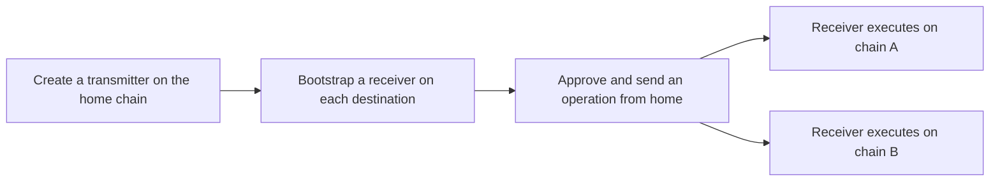
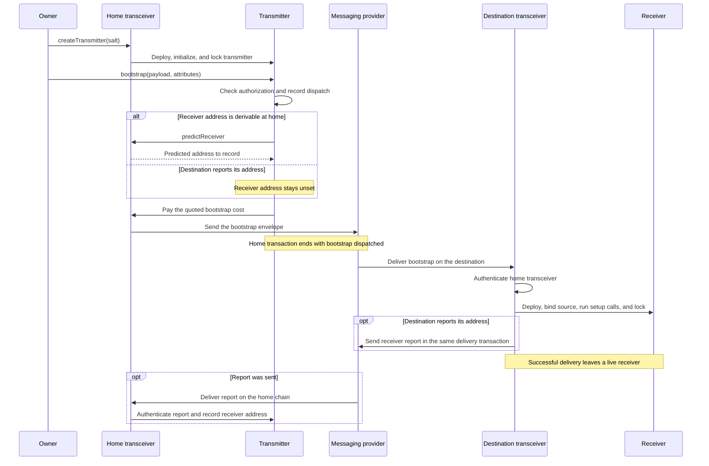
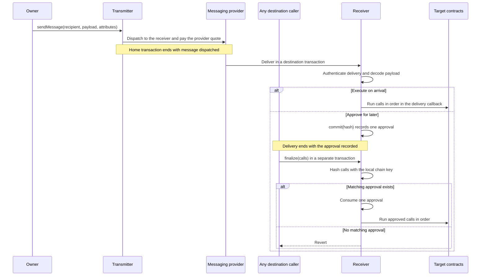
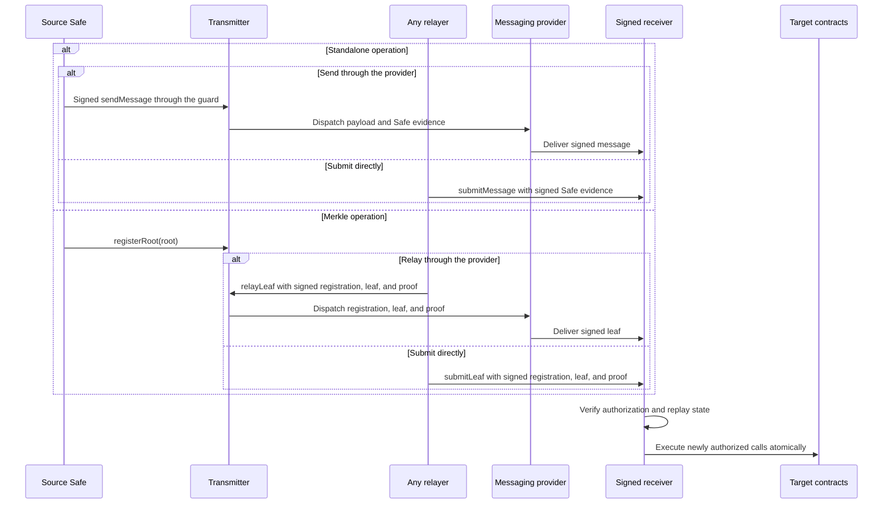
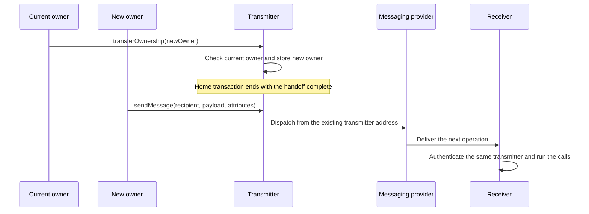
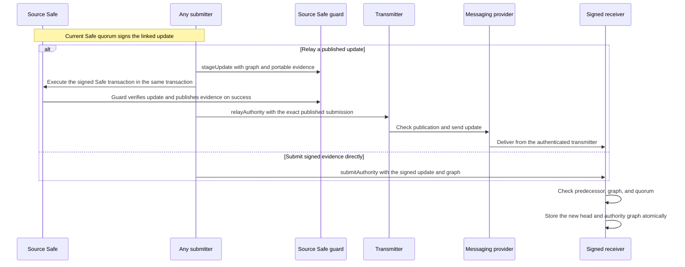
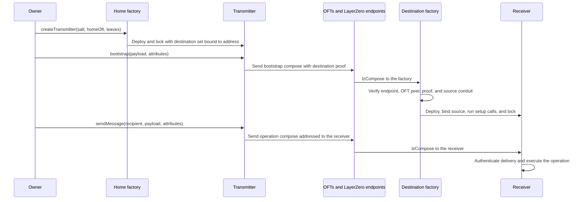

# crossecute protocol

Manage smart contracts across chains from one wallet, Safe, or DAO governor. You approve changes on a home chain you choose. A messaging provider delivers the instructions, and a receiver on each destination carries them out. This gives your team one approval process and fewer admin accounts to maintain.

## How it works

Bootstrap is a one-time setup for each destination and can run its first operation.
For later operations, send one message per destination or use a Safe-signed Merkle root
to approve multiple executions at once. Each destination settles independently.

Use the [SDK](https://github.com/crossecute/sdk) to plan an operation. See the [operator guide](docs/operator-guide.md) for setup and trust assumptions, and the [deployment checklist](docs/todo.md) for work still open before mainnet.

## Full operation flow

### Create and bootstrap

The owner chooses the home chain by calling `createTransmitter` there. The home
transceiver deploys, initializes, and locks the transmitter proxy in one transaction.
The owner can also run calls locally with `transmitter.execute(calls)`.

The bootstrap payload names the destination and its setup calls. In signed mode it
also carries the authority graph and update head selected by the source Safe's guard.
On a predicted route, home records the address at dispatch, before the receiver exists.
Wait for successful destination delivery. On a reporting route, also wait for the
report to reach home. The native LayerZero binding requires a write-once transmitter
peer for the destination.

If setup calls or the report send revert, receiver creation rolls back and the
bootstrap delivery can be retried. [Bootstrap checks, fees, and retry behavior](docs/architecture/message-flow.md#b-bootstrap-no-receiver-on-the-destination-yet)

### Send and execute

On an EVM route, `recipientOn(chainId)` returns the receiver's ERC-7930 address.
The transmitter checks the recipient, quotes the provider and protocol fees, and
sends through its own provider endpoint. The receiver authenticates the transport,
home chain, and transmitter before running the payload.

A deferred payload calls the receiver's own `commit`. A later `cancel(hash)` self-call
removes all outstanding approvals for that hash when it lands. A reverting call rolls
back its whole batch, including any approval consumed by `finalize`. Failed provider
deliveries can be retried. [Delivery and failure handling](docs/architecture/message-flow.md#failure-handling)

### Verify a Safe-signed operation

A Safe-signed receiver checks the Safe authorization against its stored authority
graph before executing. The Safe can sign a standalone send or sign a Merkle root
that covers multiple execution leaves. Each leaf names its destination, calls,
local nonce, and validity window.

Provider delivery and direct submission share replay state. Receivers follow
linked authority updates to track Safe ownership and threshold changes.
[Safe-signed dispatch](docs/safe/safe-signed-dispatch.md) ·
[Safe authority updates](docs/safe/safe-authority-updates.md)

### Change authority in plain mode

The current owner transfers ownership of the transmitter on the home chain. The
receivers authenticate the same transmitter address after the handoff, so the new
owner can use the existing receivers as soon as the transfer succeeds.

If the plain-mode owner is a Safe and its address stays the same, changing the
Safe's signers or threshold happens entirely within that Safe.

### Change authority in Safe-signed mode

The transmitter stays owned by the source Safe. The current quorum signs an update
that links the previous update head to the new authority graph. Each receiver
advances its own head and graph when it accepts the update.

Direct submission can use valid signed evidence without source execution or
publication. A receiver that missed several updates applies them in predecessor
order, optionally in one `submitAuthorityBatch` transaction.
[Safe authority transport and publication](docs/safe/safe-authority-updates.md#authority-transport-and-publication)

### Bootstrap and send through a LayerZero OFT

The `layerzero-oft` factory creates a transmitter for a fixed set of destinations
and OFTs. Messages use a zero-token OFT send and a LayerZero compose callback.

Both plain and Safe-signed conduits can use the OFT route. [OFT binding specification](docs/providers/layerzero-oft-spec.md)
