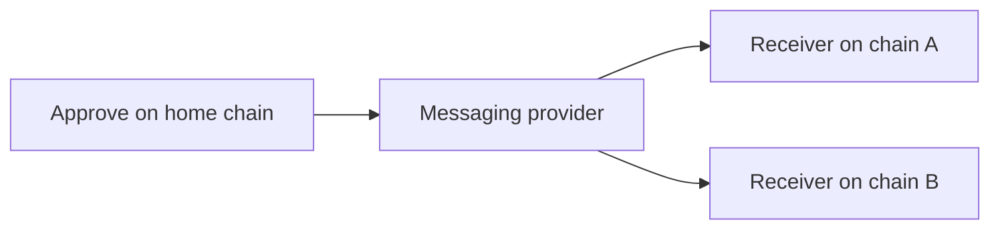

# crossecute protocol

Manage smart contracts across chains from one wallet, Safe, or DAO governor. You approve changes on a home chain you choose. A messaging provider delivers the instructions, and a receiver on each destination carries them out. This gives your team one approval process and fewer admin accounts to maintain.

Use the [SDK](https://github.com/crossecute/sdk) to plan an operation. See the [operator guide](docs/operator-guide.md) for setup and trust assumptions, and the [deployment checklist](docs/todo.md) for work still open before mainnet.
